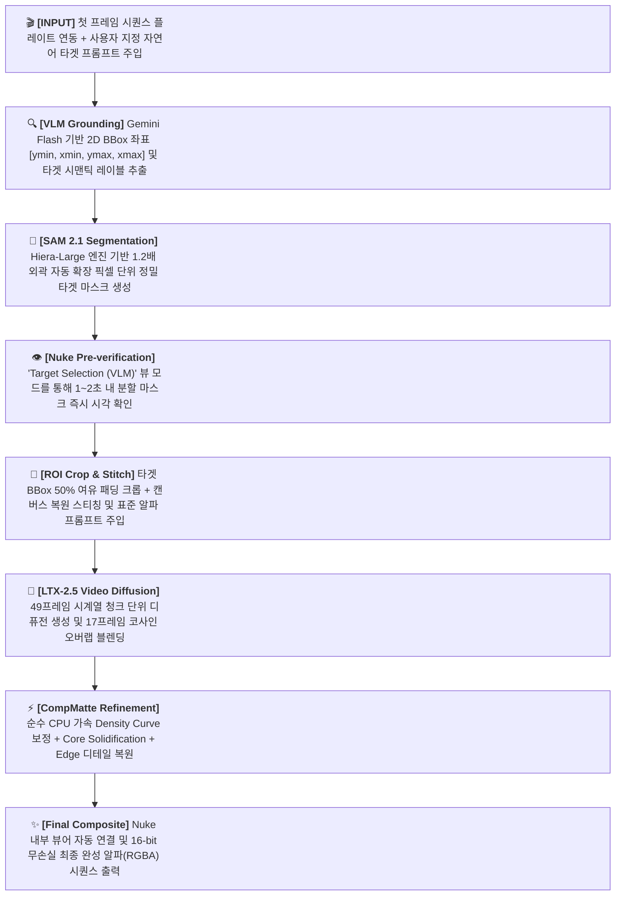
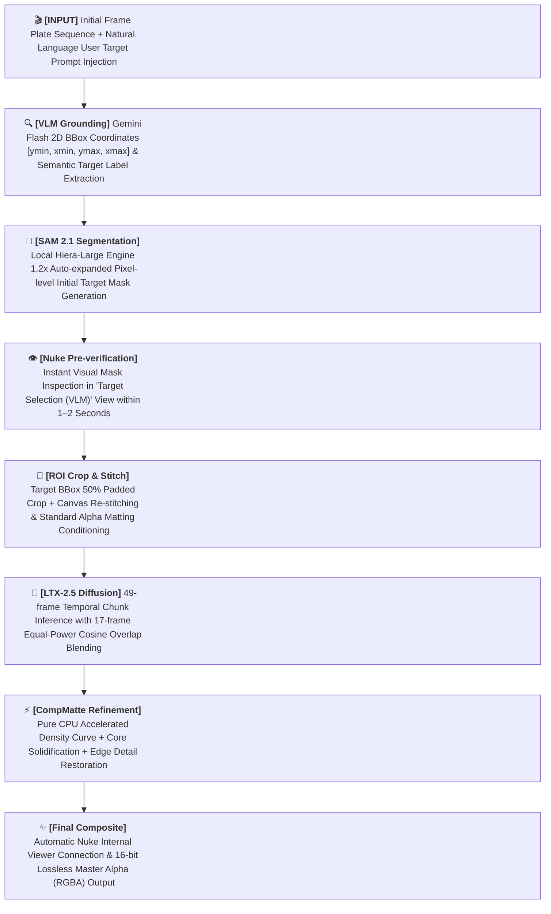

<a id="top"></a>

# AlphaGen Gizmo

<div align="center">

**🌐 Language / 언어 선택:** &nbsp;
[**🇰🇷 한국어**](#korean) &nbsp;&nbsp;|&nbsp;&nbsp; [**🇺🇸 English**](#english)

</div>

---

<a id="korean"></a>

# 🇰🇷 한국어 (Korean)

<p align="right">
  <a href="#english"><b>🌐 Switch to English (영문 버전 보기)</b></a>
</p>

**AlphaGen**은 비전-언어 모델(VLM) 기반의 객체 그라운딩, SAM2 고정밀 분할, LTX-2.5 비디오 디퓨전(IC-LoRA) 모델, 그리고 CompMatte 알고리즘 기반의 코어/엣지 분리 매트 정제를 통합한 차세대 제어형 알파 생성 시스템입니다.

Foundry Nuke 기즈모 환경에서 완벽하게 구동되며, 향후 웹 UI(FastAPI/Gradio) 및 학술 연구(논문)로 확장 가능한 이원화(Dual-Runtime) 아키텍처로 설계되었습니다.

---

## 🏗️ 시스템 아키텍처 (Pipeline Architecture)



---

## 📁 프로젝트 파일 및 폴더 구조

정밀 검수를 거쳐 불필요한 임시 파일 및 프로브 스크립트를 모두 정리하고 다음과 같이 핵심 모듈 위주로 정돈되었습니다:

```text
AlphaGen/
├── gizmos/
│   └── AlphaGen.gizmo              # 리팩토링된 Nuke 기즈모 (4단계 선형 단일 탭, 단계별 구분선, Stop/Open 버튼)
├── alphagen_nuke.py                # Nuke API & GUI 브릿지 (비동기 작업 제어, 프레임 입출력, 프로세스 트리 종료)
├── alphagen_vlm.py                 # VLM (Gemini Flash) 객체 그라운딩 & SAM2 분할 모듈
├── alphagen_worker.py              # 외부 Python 독립 AI 워커 (Nuke GIL 분리, 49프레임 청크/17프레임 오버랩, ROI 크롭)
├── alphagen_matte.py               # CPU 코어/엣지 분리 매트 정제 엔진 (순수 수학/OpenCV)
├── load_alphagen.py                # Nuke Script Editor 원클릭 실행 스크립트
├── init.py / menu.py               # Nuke 패키지 자동 경로 등록
├── experiment_config.json          # 모델 가중치 및 외부 Python 런타임 설정
├── NUKE_README.md                  # Nuke 아티스트용 상세 사용 매뉴얼
├── README.md                       # 프로젝트 종합 기술 문서 (본 파일: 한국어/English 통합)
│
├── tools/                          # 필수 실행 및 검증 도구
│   ├── run_experiment.py           # LTX 인퍼런스 실행 드라이버 (49프레임 청크 CLI 인자 자동 주입)
│   ├── ic_lora_video_only.py       # 영상 전용 IC-LoRA 파이프라인 스크립트
│   ├── ic_lora_video_only.provenance.json
│   └── check_gizmo_structure.py    # 기즈모 Tcl 문법 및 노드 연결 헤드리스 검증기
│
└── tests/                          # 100% 헤드리스 유닛 테스트 스위트
    ├── test_matte.py               # 코어/엣지 수학 및 형태학 알고리즘 검증
    ├── test_vlm.py                 # VLM 좌표 변환 및 SAM2 추론 검증
    └── test_worker.py              # 서브프로세스 IPC, 프로세스 트리 강제 종료 및 청크/격리 폴더 검증
```

---

## 🎛️ Nuke 기즈모 단일 탭 구성 (Unified Linear Workflow)

기존의 번거로운 탭 이동과 접이식 토글을 전면 제거하고, 각 단계 사이에 **시각적 네이티브 구분선**을 배치하여 위에서부터 차례대로 조작할 수 있는 **직관적인 단일 탭**으로 통합했습니다:

1. **Step 1. TARGET SELECTION (VLM & SAM2)**:
   - **Target Prompt**: 자연어 프롬프트(예: `"중앙의 갈색 셔츠를 입은 인물"`) 입력
   - **Ref Frame**: 대상이 가장 뚜렷한 기준 프레임 (기본값: `1`)
   - **Mask Expansion**: SAM 분할 마스크 외곽 자동 확장 비율 (기본값: `1.2배`, 피사체 움직임/헤어/모션 블러 여유 공간 확보)
   - **[🔍 Analyze Target (VLM)]**: 1~2초 내에 BBox 그라운딩 및 SAM2 마스크 추출 후 1.2배 자동 확장 (완료 시 뷰어 자동 전환)
2. **Step 2. LTX ALPHA VIDEO GENERATION**:
   - **First / Last**: 생성할 프레임 구간 설정 (기존 121프레임 및 $8n+1$ 수동 계산 제약을 전면 해제하여 200, 300, 1000프레임 등 원본 샷 길이 그대로 1프레임 누락 없이 100% 생성. 내부적으로 끝 프레임을 다음 $8n+1$ 경계까지 임시 자동 패딩 후 요청된 프레임 수로 정밀 크롭)
   - **[🚀 Generate Alpha Video]**: 백그라운드 LTX 비디오 디퓨전 생성 실행
   - **[⏹ Stop Queue (중단)]**: 백그라운드에서 실행 중인 큐 및 GPU/CPU 서브프로세스 트리(`taskkill /T /F`)를 즉시 강제 종료하고 VRAM 완전 회수
   - **실시간 프로그레스 바**: `[████████░░░░] 65% (LTX Denoising step 5/8)` 실시간 표시 및 작업 완료 시 결과 자동 연결
3. **Step 3. MATTE REFINEMENT (CORE & EDGE)**:
   - 노드 프로퍼티에 직접 노출된 슬라이더로 즉시 조절:
     - `Density & Alpha Curve`: Background Cutoff, White Level, Alpha Gamma
     - `Core Solidification`: Core Threshold, Inset (px), Strength, Fill Small Holes
     - `Edge & Detail Restoration`: Safe Radius (px), Edge Restoration, Edge Feather
   - **[⚡ Update Matte (CPU)]**: GPU 재실행 없이 CPU에서 밀리초 단위로 결과 즉시 갱신
4. **Step 4. OUTPUT & VIEW MODE**:
   - 7개 뷰 모드 실시간 전환 (`Final Alpha`, `Raw LTX Alpha`, `Target Selection (VLM)`, `Core`, `Edge`, `Source with Alpha`, `Premultiplied RGBA`)
   - **[📂 Open Alpha Folder]**: 현재 AlphaGen 노드가 참조 중인 격리된 알파 폴더(`.../alpha/<NodeName>/`)를 시스템 파일 탐색기에서 원클릭으로 열기

---

## 👁️ 뷰 모드 (View Modes)

- `Final alpha`: 코어 채움, 엣지 복원, CoreAdd/Garbage가 모두 적용된 최종 완성 알파.
- `Raw LTX alpha`: LTX 신경망이 생성한 순수 원시 알파.
- `Target Selection (VLM)`: VLM + SAM2가 감지한 1프레임 타겟 마스크 (**생성 전 사전 검증용**).
- `Core`: 침식 및 구멍 메우기로 확보한 고체 코어 매트.
- `Edge`: 가우시안 완화 및 고주파 디테일이 보존된 부드러운 엣지 매트.
- `Source with alpha`: 원본 RGB에 알파 채널을 주입한 상태.
- `Premultiplied RGBA`: 합성용 프리멀티플라이 결과.

---

## 📥 설치 및 설정 가이드 (Installation Guide)

AutoRoto와 동일하게 Nuke의 표준 플러그인 디렉토리(`~/.nuke/`)에 배치하여 영구 설치하거나, 즉시 실행할 수 있습니다.

### 1. Nuke 영구 설치 (권장)

Nuke가 시작될 때마다 자동으로 AlphaGen 메뉴와 노드가 로드되도록 설정합니다.

1. 사용자의 `.nuke` 디렉토리에 있는 **`init.py`** 파일(`C:\Users\<사용자명>\.nuke\init.py`)을 열고 아래 코드를 추가합니다:

   ```python
   # ~/.nuke/init.py
   import nuke
   nuke.pluginAddPath('./AlphaGen')
   ```

   *(또는 절대 경로: `nuke.pluginAddPath(r"C:\Users\<사용자명>\.nuke\AlphaGen")`)*

2. 이제 Nuke를 실행하면:
   - [init.py](init.py)가 자동으로 기즈모(`gizmos/`) 및 파이썬 모듈 경로를 등록합니다.
   - [menu.py](menu.py)가 Nuke 좌측 노드 툴바(Nodes Toolbar)에 **✦ AlphaGen** 메뉴 아이콘을 자동 생성합니다.
   - 툴바 클릭 한 번으로 `AlphaGen` 기즈모를 바로 생성할 수 있습니다.

> [!TIP]
> **단축키 지정 (선택 사항)**:
> `~/.nuke/menu.py`에 단축키(예: `Ctrl+Alt+A`)를 등록하여 더욱 빠르게 생성할 수 있습니다:
>
> ```python
> # ~/.nuke/menu.py
> toolbar = nuke.menu("Nodes")
> m = toolbar.findItem("AlphaGen") or toolbar.addMenu("AlphaGen")
> m.addCommand("AlphaGen", "import alphagen_nuke; alphagen_nuke.create()", "ctrl+alt+a")
> ```

---

### 2. 의존성 패키지 설치 (Requirements)

기존 파이썬 환경(시스템 Python 또는 기존 AI 런타임)에서 AlphaGen 폴더로 이동 후 패키지를 설치합니다:

```powershell
cd C:\Users\<사용자명>\.nuke\AlphaGen
pip install -r requirements.txt
```

> [!TIP]
> **PyTorch 환경 재사용**:
> 이미 PC에 PyTorch와 CUDA가 설치되어 있거나 ComfyUI 등의 AI 환경(`D:/AI/ComfyUI_DATA/.venv` 등)이 있다면 별도로 가상환경을 만들 필요 없이 위 명령어만 실행하면 즉시 준비가 완료됩니다.

주요 패키지 요약:

- **Deep Learning**: `torch>=2.1.0`, `torchvision>=0.16.0` (CUDA 지원 필수)
- **Vision & SAM2 Models**: `transformers>=4.45.0` (Sam2Model 지원 버전), `accelerate>=0.26.0`, `safetensors>=0.4.0`
- **Video & Image I/O**: `opencv-python>=4.8.0` (무손실 FFV1 코덱 지원), `Pillow>=10.0.0`, `numpy>=1.24.0`
- **API & Networking**: `requests>=2.28.0`

---

### 3. 환경 변수 설정 (Environment Variables)

AlphaGen이 외부 API 및 GPU 런타임을 올바르게 찾을 수 있도록 환경 변수를 설정합니다.

| 환경 변수명 | 필수 여부 | 설명 | 설정 예시 |
| :--- | :---: | :--- | :--- |
| **`GEMINI_API_KEY`** | **필수** | VLM 공간 객체 그라운딩(BBox 추출)을 위한 Google AI Studio API 키 | `AIzaSyD...` |
| **`ALPHAGEN_PYTHON`** | 선택 | AI 백엔드 Python 실행기 경로 (미설정 시 `ComfyUI` venv 또는 시스템 python 자동 탐색) | `D:\AI\ComfyUI_DATA\.venv\Scripts\python.exe` |
| **`ALPHAGEN_MODELS_DIR`** | 선택 | LTX 모델 가중치가 위치한 기본 디렉토리 경로 (미설정 시 드라이브 자동 탐색) | `D:\AI\Models` |
| **`ALPHAGEN_CACHE_DIR`** | 선택 | Nuke `Preferences.localCachePath` / `NUKE_TEMP_DIR` / 시스템 임시 폴더 자동 연동 | `D:\NukeCache\AlphaGen` |

> [!NOTE]
> **API 키 설정 방법**:
>
> 1. [Google AI Studio](https://aistudio.google.com/)에서 무료 API 키를 발급받습니다.
> 2. Windows 시스템 환경 변수에 등록하거나, `~/.nuke/init.py` 상단에 직접 추가합니다:
>
>    ```python
>    import os
>    os.environ["GEMINI_API_KEY"] = "AIzaSy..."
>    ```

---

### 4. 설치 검증 (Verification & Self-Test)

터미널에서 유닛 테스트를 실행하여 환경 및 엔진이 정상 작동하는지 확인합니다:

```powershell
python -m unittest discover -s tests -v
# 결과: Ran 27 tests ... OK
```

---

## 📁 생성된 마스크 및 결과 파일 저장 위치 (File Storage)

생성된 모든 알파 마스크는 아티스트가 Nuke 및 타 합성 툴에서 바로 연결하여 사용할 수 있도록, **원본 영상 파일이 위치한 디렉토리 하위에 `alpha/<노드이름>/` 폴더를 자동 생성**하여 저장됩니다. 동일한 Nuke 프로젝트 내에서 여러 AlphaGen 노드를 사용할 때 발생할 수 있는 파일 충돌 및 덮어쓰기를 방지하기 위해 노드 이름별로 완벽히 격리되며, 디렉토리 오염을 방지하고 작업 편의성을 극대화하기 위해 꼭 필요한 **`final/`과 `raw/` 2개 폴더 체계**로 정돈되어 출력됩니다:

```text
[원본 영상 위치]/
├── source_plate.%04d.exr           # 원본 영상 시퀀스 (또는 clip.mp4)
│
└── alpha/                          # 원본과 동일한 위치에 자동 생성되는 알파 폴더
    └── <NodeName>/                 # ★ 노드 이름별 독립 격리 하위 폴더 (예: AlphaGen1)
        ├── final/
        │   └── alpha.%06d.png      # ★ [최종 완성 알파] 16-bit 무손실 완성 알파 시퀀스 (Nuke Read_final 자동 로드)
        ├── raw/
        │   └── alpha.%06d.png      # LTX 신경망이 생성한 원시 알파 시퀀스 (Nuke Read_raw 자동 로드)
        ├── vlm_initial_mask.png    # SAM2 1.2배 자동 확장 타겟 마스크 (사전 검증용)
        ├── vlm_selection.json      # VLM 바운딩 박스 및 신뢰도 메타데이터
        └── result.json             # 최종 결과 명세서
```

> [!NOTE]
>
> - **깔끔한 산출물 관리 (raw & final 2폴더 체계)**: 사용자 프로젝트 디렉토리에는 불필요한 중간 디버그 파일 없이 최종 마스크(`final/`)와 원시 신경망 마스크(`raw/`)만 생성됩니다.
> - **노드별 폴더 격리**: 한 프로젝트에 여러 개의 AlphaGen 노드를 띄워도 각 노드의 이름(예: `AlphaGen1`, `AlphaGen2`)에 맞춰 독립된 서브폴더가 생성되므로 결과물이 서로 덮어써지지 않습니다.
> - **Nuke 설정 캐시 경로 자동 연동**: 어텐션 비디오, 모델 텐서 캐시(`*.decoded.pt`), 코어/엣지 분리 매트 등 수 기가바이트의 무거운 작업 임시 파일은 플러그인 폴더를 차지하지 않고 **Nuke의 공식 캐시 디렉토리(`Preferences.localCachePath` / `NUKE_TEMP_DIR` / `%TEMP%/nuke/AlphaGen/<job_id>/`)**로 자동 분리 격리됩니다.
> - **Nuke 뷰어 자동 연동**: 마스크 생성이 완료되면 Nuke 기즈모 내부의 `Read_final`, `Read_raw`, `Read_selection` 노드가 `<원본폴더>/alpha/<노드이름>/` 경로를, `Read_core`와 `Read_edge`는 Nuke 캐시 경로를 **100% 자동으로 연결하여 실시간 표시**합니다.
> - **Windows 파일 잠금 방어**: Nuke 백그라운드 폴링과 작업 프로세스 간 파일 충돌(`WinError 5/32`)을 방지하기 위한 재시도 및 안전 쓰기 로직이 적용되어 있습니다.
> - 원본 소스가 파일이 아닌 가상 노드(Constant 등)인 경우 Nuke 캐시 디렉토리 하위에 안전하게 자동 폴백 저장됩니다.

---

## ⚙️ 하드웨어 및 모델 사양

- **권장 GPU**: NVIDIA RTX 4080 (16GB VRAM) 이상
- **런타임**: Python 3.10 ~ 3.12 (검증 완료: Python 3.12, PyTorch 2.10+cu130)
- **기반 모델 파일 (기본 탐색 경로: `<MODELS_DIR>/`)**:
  - `LTX-2.5/diffusion_models/ltx-2.5-22b-distilled-transformer-bf16.safetensors`
  - `LTX-2.5/vae/ltx-2.5-video-vae-bf16.safetensors`
  - `gemma4-12b-with-proj-ltx-2.5-bf16.safetensors`
  - `ltx-2.5-latent-spatial-upscaler-x2-bf16-1.0.safetensors`
  - `ltx-2.5-22b-ic-lora-alpha-gen-0.9.safetensors`
- **VLM & 분할 가중치**:
  - Gemini Flash API (`GEMINI_API_KEY`)
  - HuggingFace 캐시 로컬 SAM2.1 (`facebook/sam2.1-hiera-large`)

<br>
<p align="center">
  <a href="#top"><b>⬆️ 맨 위로 이동 (Back to Top)</b></a> &nbsp;|&nbsp; <a href="#english"><b>🌐 Switch to English</b></a>
</p>

---
---

<a id="english"></a>

# 🇺🇸 English

<p align="right">
  <a href="#korean"><b>🌐 한국어로 전환 (Switch to Korean)</b></a>
</p>

**AlphaGen** is a next-generation controllable video alpha generation system integrating Vision-Language Model (VLM) object grounding, SAM2 high-precision segmentation, LTX-2.5 video diffusion (IC-LoRA), and CompMatte-based core/edge matte refinement.

Designed for production environments, AlphaGen runs natively as a Foundry Nuke Gizmo and features a dual-runtime architecture easily extensible to Web UIs (FastAPI/Gradio) and academic research.

---

## 🏗️ Pipeline Architecture



---

## 📁 Project Structure

All redundant experiment directories and obsolete debug scripts have been audited and removed:

```text
AlphaGen/
├── gizmos/
│   └── AlphaGen.gizmo              # Refactored Nuke Gizmo (4-step unified single tab, native dividers, Stop/Open buttons)
├── alphagen_nuke.py                # Nuke API & GUI bridge (async worker queue, frame I/O, process tree termination)
├── alphagen_vlm.py                 # VLM (Gemini Flash) object grounding & SAM2 segmentation module
├── alphagen_worker.py              # Standalone Python AI worker (isolated from Nuke GIL, 49-frame chunks, ROI stitch)
├── alphagen_matte.py               # CPU core/edge matte refinement engine (pure math / OpenCV)
├── load_alphagen.py                # One-click execution script for Nuke Script Editor
├── init.py / menu.py               # Automatic Nuke plugin path registration
├── experiment_config.json          # Model checkpoint and external Python runtime configuration
├── NUKE_README.md                  # Comprehensive manual for Nuke compositing artists
├── README.md                       # Complete technical documentation (this file: Korean/English unified)
│
├── tools/                          # Essential execution and validation utilities
│   ├── run_experiment.py           # LTX inference runner (automated 49-frame chunk CLI argument injection)
│   ├── ic_lora_video_only.py       # Video-only IC-LoRA pipeline script
│   ├── ic_lora_video_only.provenance.json
│   └── check_gizmo_structure.py    # Headless Gizmo Tcl syntax and node connection validator
│
└── tests/                          # 100% headless unit test suite
    ├── test_matte.py               # Core/edge morphology and density curve validation
    ├── test_vlm.py                 # VLM coordinate scaling and SAM2 inference tests
    └── test_worker.py              # IPC, process tree cancellation, per-node isolation, and chunking tests
```

---

## 🎛️ Unified Linear Workflow in Nuke Gizmo

All tab-switching and collapsible toggle groups have been replaced with a clean, top-to-bottom **unified single-tab layout** separated by visual native dividers:

1. **Step 1. TARGET SELECTION (VLM & SAM2)**:
   - **Target Prompt**: Natural language description of the subject (e.g., `"person in the center wearing brown jacket"`).
   - **Ref Frame**: Best reference frame where the subject is clearly visible (default: `1`).
   - **Mask Expansion**: Multiplier to automatically expand SAM mask boundaries (default: `1.2x`, ensuring full coverage for motion blur and fine hair).
   - **[🔍 Analyze Target (VLM)]**: Completes BBox grounding and SAM2 mask extraction in 1–2 seconds with 1.2x auto-expansion (automatically switches viewer on completion).
2. **Step 2. LTX ALPHA VIDEO GENERATION**:
   - **First / Last**: Frame range to generate. Generates full sequences (200, 300, 1000+ frames) without dropped frames. The pipeline automatically divides long shots into 49-frame chunks with 17-frame equal-power cosine blending and handles boundary padding/cropping.
   - **[🚀 Generate Alpha Video]**: Dispatches background LTX video diffusion inference.
   - **[⏹ Stop Queue]**: Immediately terminates the background process tree (`taskkill /T /F`) and completely releases GPU VRAM.
   - **Live Progress Bar**: Displays real-time progress `[████████░░░░] 65% (LTX Denoising step 5/8)` and automatically connects output on completion.
3. **Step 3. MATTE REFINEMENT (CORE & EDGE)**:
   - Interactive sliders exposed directly on node properties:
     - `Density & Alpha Curve`: Background Cutoff, White Level, Alpha Gamma
     - `Core Solidification`: Core Threshold, Inset (px), Strength, Fill Small Holes
     - `Edge & Detail Restoration`: Safe Radius (px), Edge Restoration, Edge Feather
   - **[⚡ Update Matte (CPU)]**: Millisecond-level CPU re-calculation without re-running heavy GPU models.
4. **Step 4. OUTPUT & VIEW MODE**:
   - 7 real-time view modes (`Final Alpha`, `Raw LTX Alpha`, `Target Selection (VLM)`, `Core`, `Edge`, `Source with Alpha`, `Premultiplied RGBA`).
   - **[📂 Open Alpha Folder]**: Opens the referenced per-node alpha directory (`.../alpha/<NodeName>/`) directly in the OS file explorer.

---

## 👁️ View Modes

- `Final alpha`: Fully composited matte with core solidification, edge restoration, and garbage matte logic applied.
- `Raw LTX alpha`: Raw, unrefined alpha sequence generated directly by the LTX diffusion model.
- `Target Selection (VLM)`: Single-frame initial target mask from VLM + SAM2 (**for verification prior to generation**).
- `Core`: Solid core mask generated via erosion and hole-filling to eliminate interior transparency.
- `Edge`: Soft edge band retaining fine details and high-frequency hair strands with Gaussian falloff.
- `Source with alpha`: Original RGB footage combined with the computed alpha channel.
- `Premultiplied RGBA`: Premultiplied result ready for downstream compositing.

---

## 📥 Installation & Setup Guide

AlphaGen can be permanently installed into the standard Nuke plugin directory (`~/.nuke/`) or loaded dynamically.

### 1. Permanent Nuke Installation (Recommended)

1. Open **`init.py`** in your `.nuke` folder (`C:\Users\<Username>\.nuke\init.py`) and add:

   ```python
   # ~/.nuke/init.py
   import nuke
   nuke.pluginAddPath('./AlphaGen')
   ```

   *(Or use an absolute path: `nuke.pluginAddPath(r"C:\Users\<Username>\.nuke\AlphaGen")`)*

2. When Nuke starts:
   - [init.py](init.py) automatically adds the `gizmos/` folder and Python modules to Nuke's search path.
   - [menu.py](menu.py) creates a **✦ AlphaGen** entry in the left Nodes toolbar.
   - Clicking the toolbar icon instantly creates an `AlphaGen` Gizmo node.

> [!TIP]
> **Keyboard Shortcut (Optional)**:
> Register a hotkey (e.g., `Ctrl+Alt+A`) in `~/.nuke/menu.py`:
>
> ```python
> # ~/.nuke/menu.py
> toolbar = nuke.menu("Nodes")
> m = toolbar.findItem("AlphaGen") or toolbar.addMenu("AlphaGen")
> m.addCommand("AlphaGen", "import alphagen_nuke; alphagen_nuke.create()", "ctrl+alt+a")
> ```

---

### 2. Requirements & Dependencies

In your external Python environment (system Python or existing AI virtual environment), install the required packages:

```powershell
cd C:\Users\<Username>\.nuke\AlphaGen
pip install -r requirements.txt
```

> [!TIP]
> **Reusing Existing AI Environments**:
> If you already have PyTorch and CUDA configured (e.g., ComfyUI at `D:/AI/ComfyUI_DATA/.venv`), you can point AlphaGen to it without setting up a new virtual environment.

Key dependency summary:
- **Deep Learning**: `torch>=2.1.0`, `torchvision>=0.16.0` (CUDA enabled)
- **Vision & SAM2 Models**: `transformers>=4.45.0` (with `Sam2Model`), `accelerate>=0.26.0`, `safetensors>=0.4.0`
- **Video & Image I/O**: `opencv-python>=4.8.0` (lossless FFV1 codec support), `Pillow>=10.0.0`, `numpy>=1.24.0`
- **API & Networking**: `requests>=2.28.0`

---

### 3. Environment Variables

Configure environment variables so AlphaGen can locate external APIs and GPU runtimes:

| Variable | Required | Description | Example |
| :--- | :---: | :--- | :--- |
| **`GEMINI_API_KEY`** | **Required** | Google AI Studio API key for VLM 2D bounding-box spatial grounding | `AIzaSyD...` |
| **`ALPHAGEN_PYTHON`** | Optional | Path to external Python executable running AI models (auto-detects ComfyUI venvs or system Python) | `D:\AI\ComfyUI_DATA\.venv\Scripts\python.exe` |
| **`ALPHAGEN_MODELS_DIR`** | Optional | Directory containing LTX checkpoints (auto-scans common drive paths if unset) | `D:\AI\Models` |
| **`ALPHAGEN_CACHE_DIR`** | Optional | Custom cache root (defaults to Nuke's `localCachePath` / `NUKE_TEMP_DIR` / OS temp) | `D:\NukeCache\AlphaGen` |

> [!NOTE]
> **Setting the API Key**:
> Obtain a free key from [Google AI Studio](https://aistudio.google.com/), and add it to Windows System Environment Variables or `~/.nuke/init.py`:
>
> ```python
> import os
> os.environ["GEMINI_API_KEY"] = "AIzaSy..."
> ```

---

### 4. Verification & Testing

Run the automated test suite in a terminal to confirm full engine compatibility:

```powershell
python -m unittest discover -s tests -v
# Result: Ran 27 tests ... OK
```

---

## 📁 Output File Storage & Node Isolation

Generated alpha sequences are saved in an **`alpha/<NodeName>/` subfolder alongside the original source media**, ensuring full isolation between multiple `AlphaGen` nodes within the same Nuke script:

```text
[Source Media Directory]/
├── source_plate.%04d.exr           # Original plate sequence (or clip.mp4)
│
└── alpha/                          # Root alpha folder created alongside source
    └── <NodeName>/                 # ★ Isolated per AlphaGen node instance (e.g. AlphaGen1)
        ├── final/
        │   └── alpha.%06d.png      # ★ [Final Alpha] 16-bit lossless matte (auto-loaded by Read_final)
        ├── raw/
        │   └── alpha.%06d.png      # Raw LTX diffusion matte sequence (auto-loaded by Read_raw)
        ├── vlm_initial_mask.png    # SAM2 1.2x expanded target mask (for pre-verification)
        ├── vlm_selection.json      # Bounding box coordinates and confidence metadata
        └── result.json             # Execution job manifest
```

> [!NOTE]
> - **Clean 2-Folder Scheme (`final/` & `raw/`)**: Project directories stay clean with only the essential raw and final mattes.
> - **Per-Node Isolation**: Renaming or duplicating `AlphaGen` nodes in Nuke (e.g., `AlphaGen_Hero`, `AlphaGen_BG`) routes outputs to separate subdirectories, preventing file collisions.
> - **Cache Isolation**: Heavy intermediate tensors (`*.decoded.pt`) and attention videos are routed to Nuke's official cache directory (`%TEMP%/nuke/AlphaGen/<job_id>/`), leaving zero footprint in project or plugin folders.
> - **Automatic Reload**: Internal Read nodes automatically point to the corresponding files upon generation completion. Virtual nodes (e.g., `Constant`) safely fallback to Nuke cache storage.
> - **Windows File Lock Defense**: Implements atomic write and lock-retry logic to prevent Windows access violations (`WinError 5/32`) during concurrent polling.

---

## ⚙️ Hardware & Model Specifications

- **Recommended GPU**: NVIDIA RTX 4080 (16GB VRAM) or higher
- **Runtime**: Python 3.10 ~ 3.12 (Verified: Python 3.12, PyTorch 2.10+cu130)
- **LTX Model Checkpoints (Searched under `<MODELS_DIR>/`)**:
  - `LTX-2.5/diffusion_models/ltx-2.5-22b-distilled-transformer-bf16.safetensors`
  - `LTX-2.5/vae/ltx-2.5-video-vae-bf16.safetensors`
  - `gemma4-12b-with-proj-ltx-2.5-bf16.safetensors`
  - `ltx-2.5-latent-spatial-upscaler-x2-bf16-1.0.safetensors`
  - `ltx-2.5-22b-ic-lora-alpha-gen-0.9.safetensors`
- **VLM & Segmentation Weights**:
  - Gemini Flash API (`GEMINI_API_KEY`)
  - Local HuggingFace cache: SAM2.1 (`facebook/sam2.1-hiera-large`)

<br>
<p align="center">
  <a href="#top"><b>⬆️ Back to Top (맨 위로 이동)</b></a> &nbsp;|&nbsp; <a href="#korean"><b>🌐 한국어로 전환</b></a>
</p>
